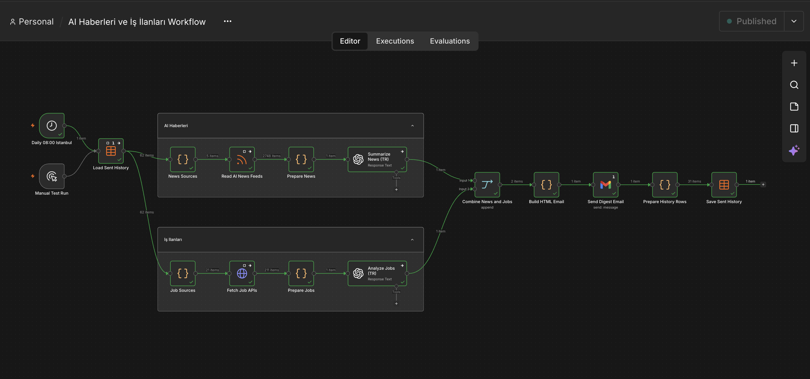
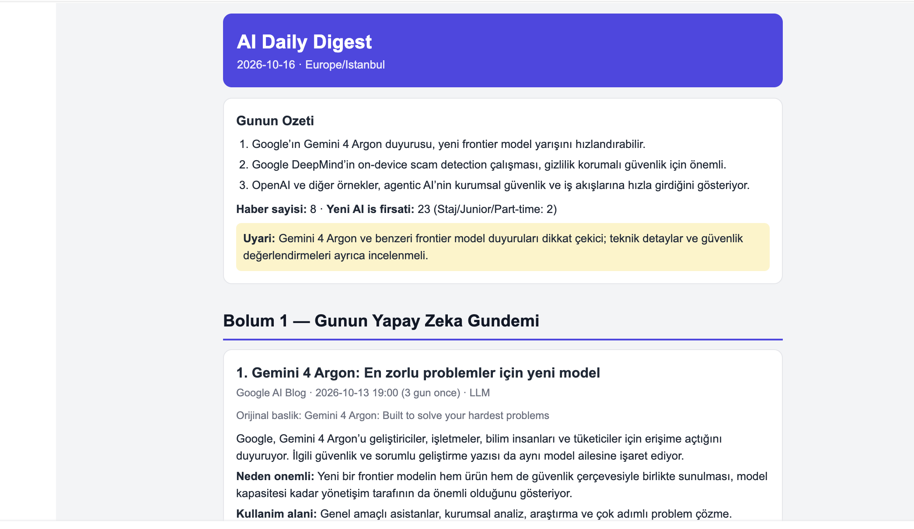
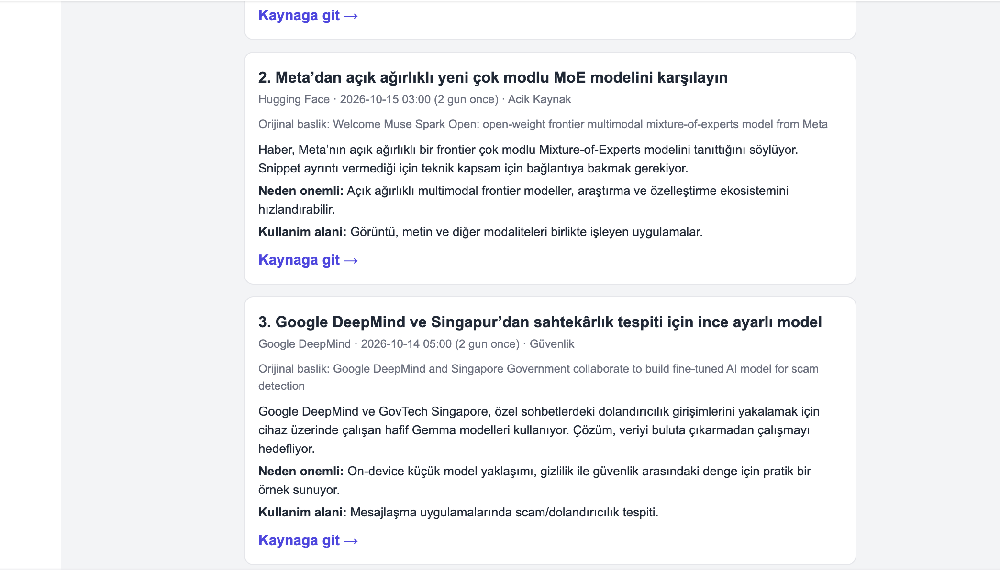
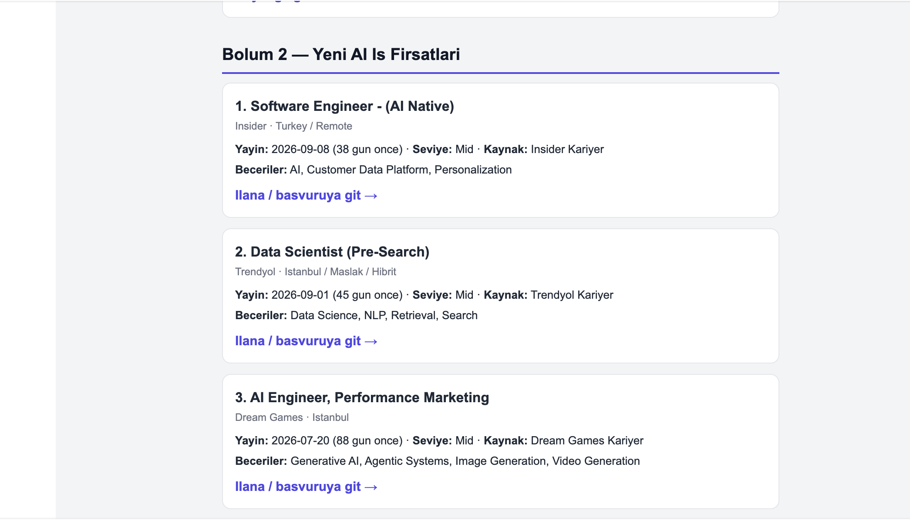

# AI Günlük Bülten — n8n Otomasyonu

Yapay zekâ haberlerini ve AI/ML iş ilanlarını otomatik olarak toplayan, analiz eden ve günlük e-posta bülteni oluşturan bir **n8n otomasyon projesi**.

##  Proje Görselleri

### Workflow

### Günlük E-posta Bülteni

**E-posta Örneği 1**

**E-posta Örneği 2**

**E-posta Örneği 3**

##  Özellikler

-  RSS kaynaklarından yapay zekâ haberlerini toplama
-  Farklı platformlardan AI/ML iş ilanlarını toplama
-  OpenAI ile haberleri Türkçe özetleme ve analiz etme
-  Staj, junior ve yeni mezun iş fırsatlarına öncelik verme
-  Daha önce gönderilmiş içerikleri filtreleme
-  Haberleri ve iş ilanlarını tek bir HTML e-posta bülteninde birleştirme
-  Günlük otomatik çalıştırma
-  Manuel çalıştırma ile test edebilme

## Kullanılan Teknolojiler

- **n8n:** Workflow ve otomasyon yönetimi
- **OpenAI API:** Haber özetleme ve iş ilanı analizi
- **RSS Feed:** Haber toplama
- **REST API:** İş ilanlarını alma
- **Gmail:** E-posta gönderimi
- **Data Table:** Gönderilmiş içeriklerin kaydedilmesi
- **HTML:** E-posta tasarımı

## Workflow Nasıl Çalışır?

1. **Zamanlayıcı:** Workflow her gün saat 08.00'de çalışacak şekilde yapılandırılır. Manuel çalıştırma da mümkündür.
2. **Haberleri toplama:** OpenAI, Google DeepMind, Google AI Blog, Hugging Face ve arXiv kaynaklarından içerikler alınır.
3. **Haberleri filtreleme:** Yeni ve ilgili haberler belirlenir; daha önce gönderilen içerikler elenir.
4. **Haberleri analiz etme:** OpenAI modeli haberleri Türkçe özetler ve önemlerini açıklar.
5. **İş ilanlarını toplama:** Remotive, Arbeitnow, Jobicy, Himalayas ve seçili şirketlerin kariyer API'leri kullanılır.
6. **İş ilanlarını filtreleme:** AI/ML alanındaki ilanlar belirlenir; staj, junior, yeni mezun ve part-time fırsatlarına öncelik verilir.
7. **İlanları analiz etme:** İlanların gereksinimleri ve öne çıkan becerileri analiz edilir.
8. **E-posta oluşturma:** Haberler ve iş ilanları HTML formatında tek bir bültende birleştirilir.
9. **E-posta gönderme:** Bülten Gmail üzerinden gönderilir.
10. **Geçmişi kaydetme:** Gönderilen içerikler Data Table'a kaydedilir.

## Kurulum ve Kullanım

### Gereksinimler

- Çalışan bir n8n kurulumu
- OpenAI API erişimi
- Gmail hesabı ve gerekli kimlik bilgileri
- Gerekli API kaynaklarına erişim
- n8n Data Table desteği

### Kurulum Adımları

1. Repository'yi bilgisayarına indir veya clone et.
2. Workflow JSON dosyasını n8n içerisine import et.
3. OpenAI ve Gmail kimlik bilgilerini yapılandır.
4. Workflow içerisindeki yer tutucuları ve Data Table ID alanlarını güncelle.
5. `ai_digest_sent_items` tablosunu aşağıdaki alanlarla oluştur:
   - `item_key`
   - `item_type`
   - `title`
   - `sent_date`
6. API adreslerini, filtreleri ve model ayarlarını kontrol et.
7. Workflow'u önce manuel çalıştırarak test et.
8. Test başarılı olduktan sonra workflow'u etkinleştir.

> **Not:** API erişimi, kimlik bilgileri ve n8n sürümüne bağlı olarak bazı ayarların güncellenmesi gerekebilir.

## Veri Kaynakları

### Yapay Zekâ Haberleri

- [OpenAI](https://openai.com/news/)
- [Google DeepMind](https://deepmind.google/discover/blog/)
- [Google AI Blog](https://blog.google/technology/google-labs/)
- [Hugging Face](https://huggingface.co/blog)
- [arXiv — Artificial Intelligence](https://arxiv.org/list/cs.AI/recent)

### İş İlanları

- [Remotive](https://remotive.com/)
- [Arbeitnow](https://arbeitnow.com/)
- [Jobicy](https://jobicy.com/)
- [Himalayas](https://himalayas.app/)

Workflow ayrıca seçili şirketlerin kariyer API'lerini de kullanır.

## Güvenlik

- API anahtarlarını, şifreleri ve OAuth bilgilerini herkese açık paylaşma.
- Workflow JSON dosyasını yüklemeden önce kişisel bilgileri ve gizli verileri kontrol et.
- Kendi kimlik bilgilerini n8n Credentials üzerinden yapılandır.
- Üçüncü taraf API'lerin kullanım koşullarına uy.

## Sınırlamalar

- Haber ve iş ilanı kaynaklarının kullanılabilirliği değişebilir.
- İlanların güncelliği ve konum bilgileri kaynaklara bağlıdır.
- Yapay zekâ tarafından oluşturulan özetler ve analizler hatalı veya eksik olabilir.
- Otomatik e-posta gönderimi için doğru yapılandırma gerekir.

## Lisans

Bu proje [MIT License](LICENSE) altında yayımlanmıştır.

---

**Amaç:** n8n, API entegrasyonları ve yapay zekâ destekli otomasyon konularında uygulamalı deneyim kazanmak ve günlük bilgi takibini kolaylaştırmak.
